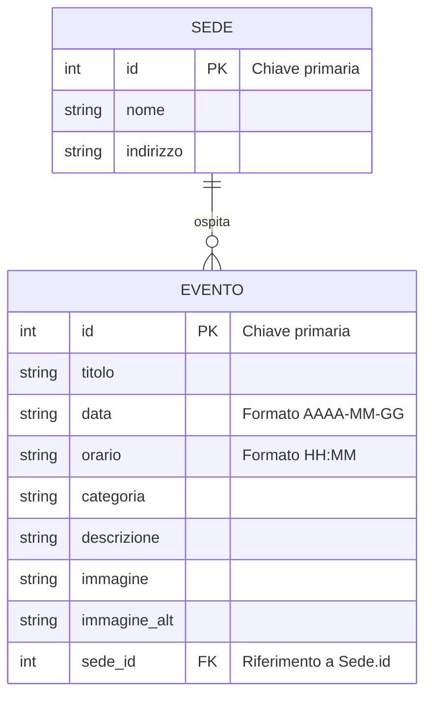

# Scheda dati — Festival Segnale

Documentazione della struttura dei dati presenti nella cartella `dati/` (`eventi.json` e `sedi.json`) per il progetto didattico del festival immaginario **Segnale**.

---

## 1. Entità

Il modello dei dati è organizzato in **due entità**:

- **Evento** (`dati/eventi.json`): rappresenta i singoli appuntamenti del programma del festival (incontri, laboratori e mostre).
- **Sede** (`dati/sedi.json`): rappresenta i luoghi fisici di riferimento che ospitano gli appuntamenti del festival.

---

## 2. Campi di ciascuna entità

### Entità `Sede` (`dati/sedi.json`)

| Campo | Tipo | Esempio | Note |
| :--- | :--- | :--- | :--- |
| `id` | Numero (intero) | `1` | Identificativo univoco della sede (chiave primaria) |
| `nome` | Stringa | `"Officina Nord — Sede centrale"` | Nome dello spazio nel festival e sede di riferimento |
| `indirizzo` | Stringa | `"Corso Duca degli Abruzzi 24, Torino"` | Indirizzo stradale completo |

### Entità `Evento` (`dati/eventi.json`)

| Campo | Tipo | Esempio | Note |
| :--- | :--- | :--- | :--- |
| `id` | Numero (intero) | `1` | Identificativo univoco dell'evento (chiave primaria) |
| `titolo` | Stringa | `"Lettere in movimento"` | Titolo dell'appuntamento |
| `data` | Stringa (ISO `AAAA-MM-GG`) | `"2026-06-12"` | Data di svolgimento dell'evento |
| `orario` | Stringa (`HH:MM`) | `"10:00"` | Orario di inizio |
| `categoria` | Stringa | `"Incontro"` | Tipologia dell'appuntamento (`Incontro`, `Laboratorio`, `Mostra`) |
| `descrizione` | Stringa | `"Come cambia un messaggio quando cambiano le lettere? Un incontro su tipografia, ritmo e comunicazione visiva."` | Breve testo descrittivo dell'evento |
| `immagine` | Stringa (percorso) | `"assets/lettere-in-movimento.svg"` | Percorso relativo dell'immagine associata |
| `immagine_alt` | Stringa | `"Lettere geometriche disposte su una griglia"` | Testo alternativo per l'accessibilità |
| `sede_id` | Numero (intero) | `1` | Riferimento all'`id` della sede in `sedi.json` (chiave esterna) |

---

## 3. Chiave primaria

Entrambe le entità utilizzano il campo **`id`** come chiave primaria:

- **`Sede.id`**: valore numerico intero, univoco all'interno di `sedi.json` e stabile nel tempo (non viene riutilizzato o modificato se cambia il nome o l'ordine dei record).
- **`Evento.id`**: valore numerico intero, univoco all'interno di `eventi.json` e stabile nel tempo (non è necessario che gli ID siano consecutivi).

---

## 4. Relazione tra le entità

Tra **Sede** ed **Evento** esiste una relazione **uno-a-molti (`1:N`)**:

- Una **sede** può ospitare **più eventi** (in questo programma, due eventi per ciascuna sede).
- Ogni **evento** si svolge in **una sola sede**.

Il collegamento avviene tramite chiave esterna: il campo **`Evento.sede_id`** fa riferimento al campo **`Sede.id`**. In questo modo nome e indirizzo di ogni luogo sono memorizzati una sola volta in `sedi.json`, evitando duplicazioni e incoerenze.

---

## 5. Quantità dei dati

L'insieme attuale dei dati contiene:

- **6 eventi** in `dati/eventi.json` (tre il venerdì 12 giugno e tre il sabato 13 giugno).
- **3 sedi** in `dati/sedi.json` (`Officina Nord — Sede centrale`, `Spazio Forma — Sede al Valentino`, `Cortile Comune — Sede di Mirafiori`).

---

## 6. Chi aggiorna i dati e come

I dati vengono aggiornati da chi cura il progetto (autore/autrice del sito o redazione del festival) modificando direttamente i file JSON (`dati/eventi.json` e `dati/sedi.json`) nella repository del progetto.

Il flusso di aggiornamento prevede:

1. Modifica dei file JSON in locale (o direttamente nell'editor della repository), rispettando lo schema dei campi e la sintassi JSON valida.
2. Verifica dei dati e salvataggio delle modifiche tramite commit e push sulla repository.
3. Pubblicazione (deploy) aggiornata del sito, così che la pagina legga automaticamente i nuovi contenuti senza dover riscrivere la struttura HTML.

---

## 7. Che cosa mostra la pagina

La pagina del programma (`programma.html`) legge i dati dai due file JSON e genera le schede degli appuntamenti del festival. Per ciascun evento mostra:

- l'**immagine** con il relativo **testo alternativo** (`immagine`, `immagine_alt`);
- i metadati principali: **data**, **orario** e **categoria** (`data`, `orario`, `categoria`);
- il **titolo** e la **descrizione** (`titolo`, `descrizione`);
- la **sede** (nome e, se richiesto, indirizzo), recuperata automaticamente da `sedi.json` abbinando `Evento.sede_id` a `Sede.id`.

---

## Schema Evento–Sede

